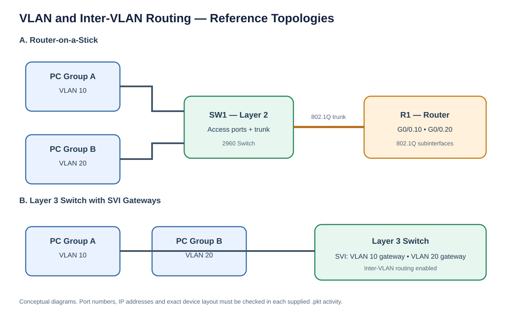
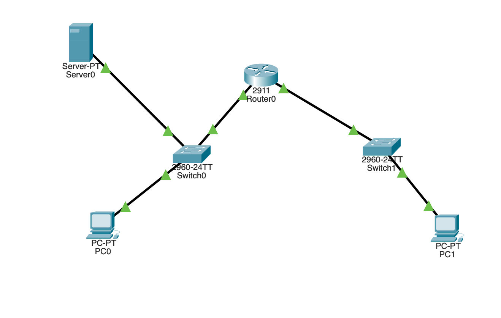
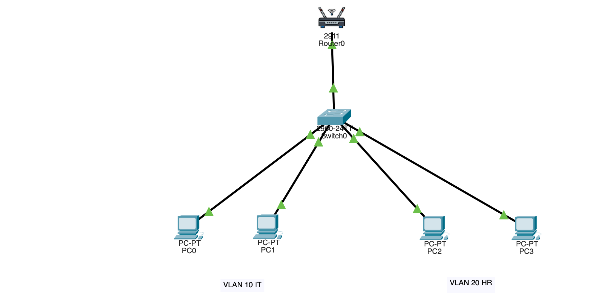
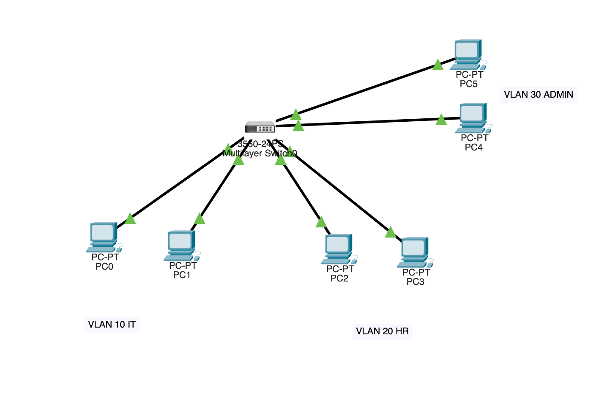

# Project 01: VLAN and Inter-VLAN Routing

A Cisco Packet Tracer lab collection demonstrating VLAN segmentation, trunking, inter-VLAN communication, Layer 3 switching, troubleshooting, and IPv4 address planning.

## Objectives

- Create VLANs and assign switch access ports.
- Configure trunk links and understand IEEE 802.1Q tagging.
- Enable communication between VLANs using Router-on-a-Stick.
- Configure Layer 3 switch SVIs for inter-VLAN routing.
- Practice troubleshooting VLAN and trunk configuration issues.
- Apply IPv4 subnetting and VLSM to network addressing.

## Topology



The diagram shows two common approaches covered in this project collection: Router-on-a-Stick and Layer 3 switch SVI routing. The project contains multiple Packet Tracer activities; open each `.pkt` file to inspect its exact topology and device connections. The diagram is a conceptual reference, not a claim that every activity uses both approaches.

### Submitted Packet Tracer Screenshots







These images are the screenshots already stored in this project's `screenshots/` directory.


## Lab Files

| File | Focus |
|---|---|
| `vlan_inter_vlan_routing.pkt` | VLAN configuration and inter-VLAN routing |
| `vlan_svi.pkt` | Layer 3 switch SVI-based routing |
| `vlan_troubleshoting.pkt` | VLAN and trunk troubleshooting practice |
| `Lab-03-Inter-LAN-Routing.pkt` | Routing between multiple LANs |
| `vlsip.pkt` | VLSM addressing practice |

Screenshots: `screenshots/ss.png`, `screenshots/vlan.png`, and `screenshots/vlan_svi.png`.

## Concepts Covered

- VLAN creation and port assignment
- Access and trunk modes
- IEEE 802.1Q
- Router-on-a-Stick
- Inter-VLAN routing
- Layer 3 switch and Switch Virtual Interfaces (SVIs)
- VLAN troubleshooting
- IPv4 subnetting and VLSM

## Verification Commands

```text
show vlan brief
show interfaces trunk
show interfaces switchport
show ip interface brief
show ip route
show running-config
```

Use the relevant commands on the corresponding device and verify interface status, VLAN membership, trunk operation, and routing entries.

## Connectivity Tests

The exact addressing and test results are specific to each saved Packet Tracer activity. Verify the final topology and IP configuration in each `.pkt` file before recording pass/fail results. No unverified ping result is claimed in this README.

## Learning Outcomes

This project collection builds practical understanding of Layer 2 VLAN segmentation, trunk links, inter-VLAN routing, Layer 3 switching, troubleshooting, and IP address planning.
