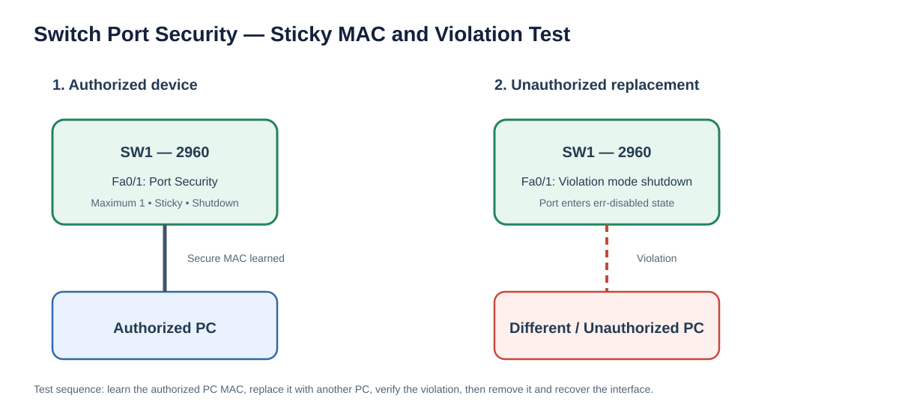

# Project 05: Switch Port Security

A Cisco Packet Tracer lab demonstrating MAC address control on a switch access port using sticky MAC learning and port-security violation handling.

## Objectives

- Enable port security on an access port.
- Limit the number of secure MAC addresses.
- Learn an authorized device MAC address using sticky learning.
- Trigger a violation by connecting a different device.
- Observe the secure-shutdown / err-disabled state.
- Recover the interface after removing the unauthorized device.

## Topology



The diagram shows the two stages of the lab: first, the authorized PC is learned as a sticky secure MAC; then a different PC is connected to test the violation action. Open the Packet Tracer file to inspect the exact device and port layout.

Devices used:
- 1 Cisco 2960 switch
- Authorized PC connected to Fa0/1
- An alternate PC used to test a port-security violation

## Port Security Configuration

The example configuration below was applied to Fa0/1:

```text
enable
configure terminal
interface fa0/1
switchport mode access
switchport port-security
switchport port-security maximum 1
switchport port-security mac-address sticky
switchport port-security violation shutdown
end
```

The switch learns the authorized PC's MAC address as a sticky secure MAC address. The maximum secure MAC address count is one, and the violation mode is shutdown.

## Verification Commands

```text
show port-security
show port-security interface fa0/1
show port-security address
show mac address-table
show interfaces status
```

## Connectivity and Security Tests

The following results were observed during the lab:

| Test ID | Action | Result |
|---|---|---|
| TC-01 | Authorized PC MAC learned as sticky secure address | Pass |
| TC-02 | Connect a different PC to the protected port | Security violation |
| TC-03 | Check interface state after violation | Secure-shutdown / err-disabled |
| TC-04 | Remove unauthorized device and recover the interface | Secure-up |

The violation counter was observed at 1 after the unauthorized device test. After interface recovery, the port returned to Secure-up and the violation counter reset to 0.

## Recovery

Remove the unauthorized device first, then recover the interface:

```text
enable
configure terminal
interface fa0/1
shutdown
no shutdown
end
```

Verify the secure MAC address and interface state again after recovery.

## Files

- `port_security.pkt` — Packet Tracer lab file.

## Learning Outcomes

This lab demonstrates MAC address learning, sticky port security, maximum secure MAC limits, violation handling, err-disabled behavior, and interface recovery.
