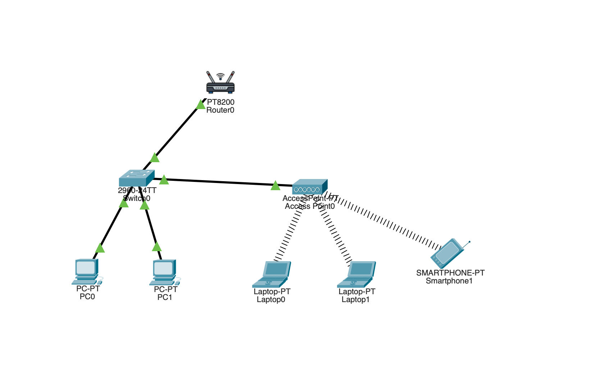

# Project 04: Small Office Wired and Wireless Network

A Cisco Packet Tracer lab demonstrating how wired and wireless devices can
communicate on the same IPv4 LAN using a switch and a wireless access point.

## Objectives

- Connect wired PCs to an Ethernet switch.
- Connect an access point to the same switch.
- Associate laptops and a smartphone with the wireless network.
- Use one IPv4 subnet for the wired and wireless clients.
- Verify wired-to-wired, wired-to-wireless, wireless-to-wireless, and
  client-to-gateway connectivity.
- Observe ARP broadcast and ICMP unicast traffic in Simulation Mode.

## Topology

Devices visible in the submitted topology:
- 1 PT8200 wireless router (Router0)
- 1 Cisco 2960-24TT switch
- 1 AccessPoint-PT
- 2 PCs
- 2 laptops
- 1 smartphone

The switch connects the wired PCs, the wireless access point, and the router.
The laptops and smartphone associate with the access point over Wi-Fi.

## IPv4 Addressing Plan

Subnet mask: `255.255.255.0` (`/24`).

| Device | Planned IPv4 address | Default gateway |
|---|---|---|
| Router / LAN gateway | `192.168.10.1` | — |
| PC0 | `192.168.10.10` | `192.168.10.1` |
| PC1 | `192.168.10.11` | `192.168.10.1` |
| Laptop0 | `192.168.10.12` | `192.168.10.1` |
| Laptop1 | `192.168.10.13` | `192.168.10.1` |
| Smartphone1 | `192.168.10.14` | `192.168.10.1` |

> Verify the final IP values in the saved `.pkt` file before publishing. The
> addressing table records the plan used during the lab discussion.

## Wireless Configuration

The access point was configured with:
- SSID: `Office-WiFi`
- Security: WPA2-PSK
- Encryption: AES
- Passphrase: `Office@2026`

The access point provides wireless connectivity. The router provides the
default gateway function. The switch connects the wired PCs, router, and AP
within the same LAN.

> Security note: `Office@2026` is a lab example password. Do not reuse it for
> real networks. If the actual Packet Tracer file uses a different SSID or
> passphrase, update this section to match the saved configuration.

## Connectivity Tests

All five tests below were reported as successful in the lab:

| Test ID | Source | Destination | Result |
|---|---|---|---|
| TC-01 | PC0 | PC1 (`192.168.10.11`) | Pass |
| TC-02 | Laptop | PC0 (`192.168.10.10`) | Pass |
| TC-03 | PC0 | Laptop (`192.168.10.12`) | Pass |
| TC-04 | Laptop | Smartphone (`192.168.10.14`) | Pass |
| TC-05 | Laptop | Default gateway (`192.168.10.1`) | Pass |

## Simulation Mode: ARP and ICMP

The lab was used to study traffic between a wired PC and a wireless client.

When the sender does not already know the destination MAC address:
1. It sends an ARP Request as a broadcast.
2. The destination replies with an ARP Reply (unicast).
3. The sender can then send the ICMP Echo Request to the destination MAC.
4. The destination returns an ICMP Echo Reply.

When the ARP cache already contains a valid mapping, a new ARP request is
usually not required. ICMP is used by the ping test; ordinary application
traffic does not require ICMP Echo Request/Reply.

Because the clients are in the same `/24` subnet, traffic between them is
forwarded within the local Layer 2 network through the AP and switch. It does
not need to be routed by the default gateway.

## Files

- `screenshots/01-wired-wireless-office-topology.png` — submitted topology.
- `ip-addressing.txt` — addressing plan.
- `configs/wireless-config-reference.txt` — wireless settings reference.
- `test-results.md` — connectivity test summary.

## Learning Outcomes

This lab demonstrates the roles of a router, switch, and access point; the
difference between wired and wireless access; same-subnet communication;
ARP-based MAC address discovery; and basic ICMP connectivity testing.
