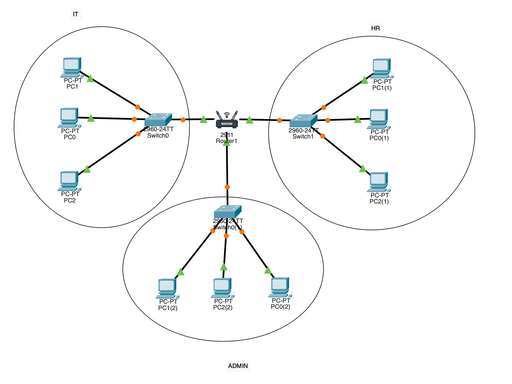

# Project 03: Three-LAN Office Network

A beginner-level Cisco Packet Tracer lab that connects three separate office LANs
(Admin, IT, and HR) through one router with three Ethernet interfaces.

## Objectives

- Build three separate LANs using switches.
- Assign a different IPv4 subnet to each LAN.
- Configure one router interface as the default gateway for each LAN.
- Verify inter-LAN communication with ICMP ping.
- Inspect the router routing table and interface status.
- Practice basic troubleshooting by shutting down one router interface and
  verifying that the other LANs remain connected.

## Topology



The lab contains:
- 1 Cisco 2911 router
- 3 Cisco 2960 switches
- 9 PCs (3 PCs per department)

## IPv4 Addressing Plan

Subnet mask for all three LANs: `255.255.255.0` (`/24`).

| Department | Network | Router interface / gateway | Example PC addresses |
|---|---|---|---|
| IT | `192.168.10.0/24` | G0/0 — `192.168.10.1` | `192.168.10.10`, `.11`, `.12` |
| HR | `192.168.20.0/24` | G0/1 — `192.168.20.1` | `192.168.20.10`, `.11`, `.12` |
| Admin | `192.168.30.0/24` | G0/2 — `192.168.30.1` | `192.168.30.10`, `.11`, `.12` |

Default gateway for each PC: the router interface address in that PC's own subnet.

> Note: The PC address ranges above document the lab's addressing plan. Confirm
> the individual PC settings in the `.pkt` file before making changes.

## Router Configuration

The following is a reference configuration matching the lab's addressing plan.
Use it as documentation; the saved Packet Tracer file is the source of truth.

```text
enable
configure terminal

interface gigabitEthernet 0/0
 ip address 192.168.10.1 255.255.255.0
 no shutdown
exit

interface gigabitEthernet 0/1
 ip address 192.168.20.1 255.255.255.0
 no shutdown
exit

interface gigabitEthernet 0/2
 ip address 192.168.30.1 255.255.255.0
 no shutdown
exit

end
```

Reference commands used for verification:

```text
show ip route
show ip interface brief
```

## Routing Table Findings

The router showed these directly connected routes:

| Route code | Network / local address | Interface |
|---|---|---|
| C | `192.168.10.0/24` | G0/0 |
| L | `192.168.10.1/32` | G0/0 |
| C | `192.168.20.0/24` | G0/1 |
| L | `192.168.20.1/32` | G0/1 |
| C | `192.168.30.0/24` | G0/2 |
| L | `192.168.30.1/32` | G0/2 |

- `C` means directly connected network.
- `L` means the router's own local interface address.
- `Gateway of last resort is not set` is expected in this lab because all three
  required LANs are directly connected and no default route was configured.

The interface verification output showed G0/0, G0/1, and G0/2 as `up/up`.
VLAN1 was unassigned and administratively down; it was not used in this lab.

## Connectivity Tests

The following cross-LAN ping tests were performed:

| Source department | Destination | Observed result |
|---|---|---|
| IT | HR PC `192.168.20.10` | 3 replies / 4 sent (25% loss on first test) |
| HR | Admin PC `192.168.30.10` | 4 replies / 4 sent (0% loss) |
| Admin | IT PC `192.168.10.10` | 4 replies / 4 sent (0% loss) |

The first IT-to-HR ping had one initial timeout. This can occur during initial
ARP resolution or Packet Tracer's first-packet handling; it is not enough by
itself to conclude there is a persistent network fault. Repeat the ping to
confirm stable connectivity.

## Troubleshooting Exercise

1. Shut down router interface G0/2.
2. Confirm that traffic from IT to the HR LAN fails.
3. Confirm that IT-to-Admin communication still succeeds.
4. Restore G0/2 using `no shutdown`.
5. Verify that G0/2 returns to `up/up`.

Commands:

```text
enable
configure terminal
interface gigabitEthernet 0/2
shutdown
```

Restore:

```text
enable
configure terminal
interface gigabitEthernet 0/2
no shutdown
end
```

This demonstrates that a failure on one router interface isolates its connected
LAN, while the other directly connected LANs can continue communicating.

## Screenshots

- `screenshots/01-three-lan-topology.png` — overall topology.
- `screenshots/02-it-to-hr-ping.png` — IT to HR connectivity test.
- `screenshots/03-hr-to-admin-ping.png` — HR to Admin connectivity test.
- `screenshots/04-admin-to-it-ping.png` — Admin to IT connectivity test.

## Packet Tracer File

The supplied Packet Tracer project is included as `Three-LAN-Office.pkt`.
Before publishing, open it in Cisco Packet Tracer and confirm that the topology,
PC addressing, and router interfaces match this README.

## Tools

- Cisco Packet Tracer
- IPv4 addressing and subnetting
- Ethernet switching
- Router interfaces and directly connected routes
- ARP and ICMP (ping)

## Learning Outcome

This lab demonstrates how one router with three routed Ethernet interfaces can
connect three separate IPv4 LANs, how directly connected routes appear in the
routing table, and how an interface failure affects only its attached network.
