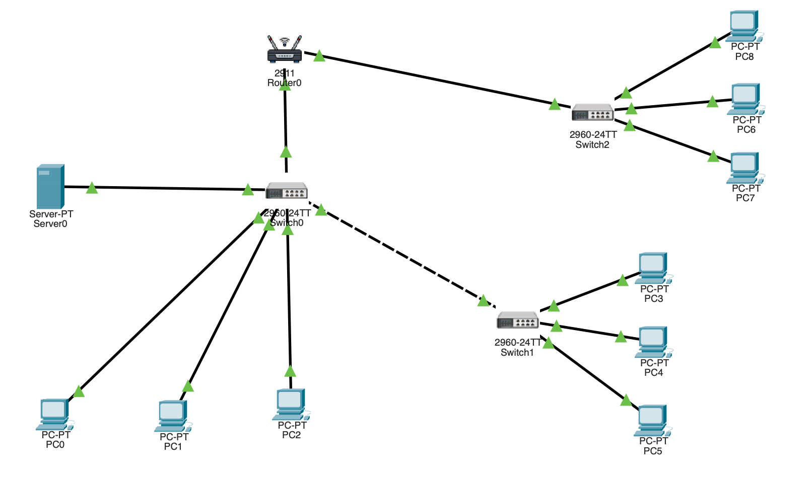
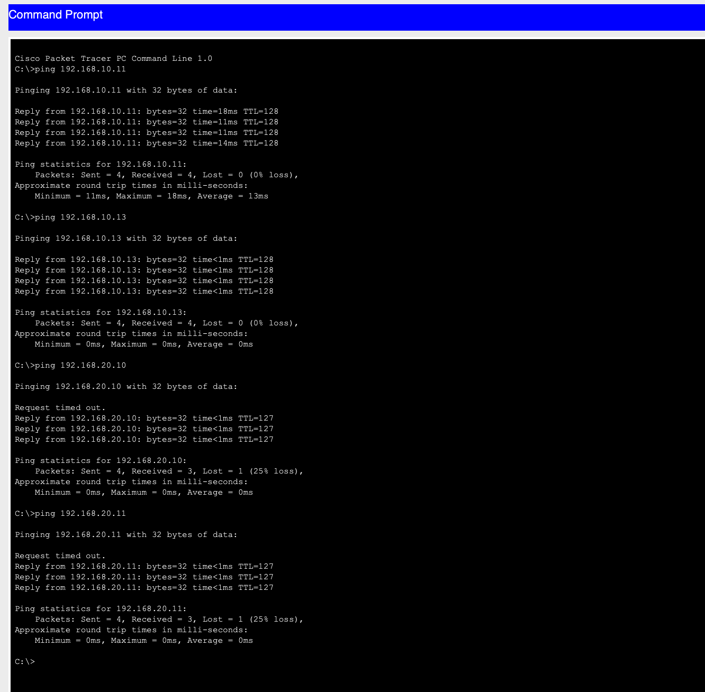

# Project 06: DHCP Server and DHCP Relay Network

A Cisco Packet Tracer lab demonstrating centralized Dynamic Host Configuration Protocol (DHCP) for multiple LANs. One DHCP Server provides automatic IPv4 configuration to clients in its local LAN and to clients in a remote LAN through a Cisco 2911 router acting as a DHCP relay agent.

## Objectives

- Build a small multi-switch office network using a Cisco 2911 router.
- Configure a dedicated Server-PT device with a static IPv4 address.
- Create separate DHCP pools for two IPv4 networks.
- Assign addresses automatically to client PCs.
- Understand why a DHCP broadcast does not normally cross a router.
- Configure ip helper-address on the router interface connected to the remote LAN.
- Observe DHCP Discover, Offer, Request, and Acknowledge (DORA) messages.
- Verify DHCP leases and end-to-end connectivity.

## Topology

See the submitted DHCP configuration and connectivity screenshots in the [Screenshots](#screenshots) section below. The topology used for the lab is described in the device and network layout sections.

The submitted topology contains:
- 1 Cisco 2911 router (Router0)
- 3 Cisco 2960-24TT switches (Switch0, Switch1, Switch2)
- 1 Server-PT device (Server0)
- 9 PCs (PC0 through PC8)

### Network layout

- **LAN 1 — Server and local clients:** Server0 and PC0–PC2 connect to Switch0. Switch1 is connected downstream from Switch0 and provides additional access ports for PC3–PC5. In the planned configuration, Switch0 and Switch1 are part of the same LAN and broadcast domain.
- **LAN 2 — Remote clients:** Switch2 connects to the router's second LAN-facing interface and provides access for PC6–PC8.
- **Central DHCP Server:** Server0 is located in LAN 1 and provides DHCP service to both LANs.
- **DHCP Relay:** Router0 forwards DHCP requests received from LAN 2 to Server0.

> **Topology assumption:** Switch0 and Switch1 are treated as one Layer 2 LAN (same VLAN) for this lab. If VLANs or separate subnets are later configured on that switch-to-switch connection, the addressing and relay design must be updated accordingly. Confirm the actual router interface names and cable connections in the saved .pkt file.

## IPv4 Addressing Plan

Subnet mask for both LANs: **255.255.255.0 (/24)**.

| Segment | Device / role | IPv4 address | Default gateway |
|---|---|---|---|
| LAN 1 | Router0 G0/0 | 192.168.10.1 | — |
| LAN 1 | Server0 (static) | 192.168.10.2 | 192.168.10.1 |
| LAN 1 | PC0–PC5 | DHCP from 192.168.10.0/24 pool | 192.168.10.1 |
| LAN 2 | Router0 G0/1 | 192.168.20.1 | — |
| LAN 2 | PC6–PC8 | DHCP from 192.168.20.0/24 pool | 192.168.20.1 |

The router interface names above are the configuration plan. Use the actual connected interfaces if the Packet Tracer cabling differs.

## Server0 Static Configuration

Configure Server0 at **Desktop → IP Configuration → Static**:

| Field | Value |
|---|---|
| IP address | 192.168.10.2 |
| Subnet mask | 255.255.255.0 |
| Default gateway | 192.168.10.1 |
| DNS server | 8.8.8.8 |

The DHCP Server itself uses a static IP so that clients and the router relay can consistently reach it.

## DHCP Pool Configuration

Open **Server0 → Services → DHCP** and turn DHCP service ON. Create both pools; do not replace the first pool when adding the second.

### Pool 1 — OFFICE-LAN

| Field | Value |
|---|---|
| Pool name | OFFICE-LAN |
| Default gateway | 192.168.10.1 |
| DNS server | 8.8.8.8 |
| Start IP address | 192.168.10.100 |
| Subnet mask | 255.255.255.0 |
| Maximum users | 50 |

This pool serves the clients on Switch0 and Switch1 (PC0–PC5), assuming both switches remain in the same LAN.

### Pool 2 — LAN-2

| Field | Value |
|---|---|
| Pool name | LAN-2 |
| Default gateway | 192.168.20.1 |
| DNS server | 8.8.8.8 |
| Start IP address | 192.168.20.100 |
| Subnet mask | 255.255.255.0 |
| Maximum users | 50 |

This pool serves the remote clients PC6–PC8 connected through Switch2.

### Submitted DHCP Configuration Screenshot

## Router Configuration

The router provides the default gateway for each LAN. Configure the interface connected to Switch0 as LAN 1 and the interface connected to Switch2 as LAN 2.

Reference configuration (adjust interface names to match the actual cabling):

~~~text
enable
configure terminal

interface gigabitEthernet 0/0
 description LAN-1-SERVER-AND-LOCAL-CLIENTS
 ip address 192.168.10.1 255.255.255.0
 no shutdown
exit

interface gigabitEthernet 0/1
 description LAN-2-REMOTE-CLIENTS
 ip address 192.168.20.1 255.255.255.0
 ip helper-address 192.168.10.2
 no shutdown
exit

end
~~~

### Why is ip helper-address required?

A new DHCP client sends DHCP Discover as a local broadcast. Routers do not normally forward this broadcast to another IP subnet.

The command:

~~~text
ip helper-address 192.168.10.2
~~~

is configured on the router interface that receives DHCP broadcasts from LAN 2. The router relays the request to the DHCP Server at 192.168.10.2. The relay information identifies the client-facing subnet (through the relay gateway address / GIADDR), allowing the DHCP Server to choose the matching pool.

- LAN 1 clients are in the same subnet as Server0, so their DHCP broadcasts can reach the server directly. No relay is needed on the LAN 1 interface.
- LAN 2 clients are in a different subnet, so the relay is needed on the LAN 2-facing router interface.
- The IP after ip helper-address is the **DHCP Server's address**, not the router interface address.

## Client Configuration

On each PC, open **Desktop → IP Configuration → DHCP**.

Expected address ranges:

| Client group | Expected DHCP range | Gateway |
|---|---|---|
| PC0–PC5 (LAN 1) | 192.168.10.100 onward | 192.168.10.1 |
| PC6–PC8 (LAN 2) | 192.168.20.100 onward | 192.168.20.1 |

The exact lease order may differ. Check the actual assigned values with ipconfig.

## Verification Commands

On Router0:

~~~text
show ip interface brief
show running-config
show ip route
~~~

On each PC:

~~~text
ipconfig
ping 192.168.10.1
ping 192.168.10.2
~~~

For LAN 2 clients, also test:

~~~text
ping 192.168.20.1
ping 192.168.10.2
~~~

After confirming the LAN 1 PC address, test cross-LAN connectivity by pinging that actual address from a LAN 2 PC.

## DHCP DORA in Simulation Mode

Use Packet Tracer **Simulation Mode** and filter for DHCP:

1. **Discover:** the client broadcasts to locate a DHCP server.
2. **Offer:** the DHCP server offers an available address and options.
3. **Request:** the client requests the offered address.
4. **Acknowledge (ACK):** the server confirms the lease.

For a LAN 2 client, observe that the Discover reaches the router relay and is forwarded to Server0. Inspect the relay information in the packet details when available.

## Connectivity and Test Results

The submitted ping screenshot records successful replies from 192.168.10.11 and 192.168.10.13 (4/4 each). The destinations 192.168.20.10 and 192.168.20.11 each returned 3/4 replies, with the first request timing out. This demonstrates reachability to both remote addresses in the captured test, but the initial packet loss should be rechecked with repeat pings.

The screenshot does not identify the source PC and does not show client DHCP configuration. DHCP pool assignment should be verified separately using ipconfig or the PC IP Configuration window. See [test-results.md](test-results.md) for the recorded details.

| Test ID | Source | Destination / action | Result |
|---|---|---|---|
| TC-01 | PC0–PC5 | Receive an address from the OFFICE-LAN pool | To be verified |
| TC-02 | PC6–PC8 | Receive an address from the LAN-2 pool through DHCP relay | To be verified |
| TC-03 | LAN 1 client | Ping LAN 1 gateway 192.168.10.1 | To be verified |
| TC-04 | LAN 2 client | Ping LAN 2 gateway 192.168.20.1 | To be verified |
| TC-05 | LAN 2 client | Ping DHCP Server 192.168.10.2 | To be verified |
| TC-06 | LAN 1 client | Ping a LAN 2 client | To be verified |
| TC-07 | LAN 2 client | Ping a LAN 1 client | To be verified |

## Screenshots

### DHCP Server Configuration

### Connectivity Test Results

These are the image files currently stored in this project's `screenshots/` directory.

## Files and Evidence

- dhcp.pkt — Packet Tracer project file (to be uploaded).
- screenshots/dhcp.png — submitted DHCP configuration screenshot.
- screenshots/result.png — submitted ping test screenshot.
- ip-addressing.txt — addressing plan.
- dhcp-pool-reference.txt — DHCP Server pool settings.
- router-config-reference.txt — Router gateway and DHCP relay configuration.
- test-results.md — test result record.

## Learning Outcomes

This project demonstrates centralized DHCP for multiple LANs, static addressing for infrastructure services, DHCP pool selection, router interfaces as default gateways, DHCP relay operation, the role of GIADDR, and DORA packet flow across a routed network.
